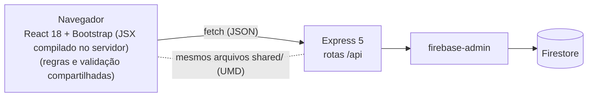

# Casos de uso — Sistema de Atendimento e Matrículas

Atores: **Secretaria** (monta a oferta de turmas) e **Aluno** (matricula-se). O login cria uma sessão no servidor (cookie `HttpOnly`); a API confere perfil e dono dos dados em cada rota (ver "Autenticação e permissões" no README).

## 1. Visão geral

| UC | Ator | Objetivo | Regras |
|---|---|---|---|
| UC01 | Secretaria | Manter disciplinas e pré-requisitos | V1, R7 |
| UC02 | Secretaria | Manter professores e a carga máxima | V1 |
| UC03 | Secretaria | Ofertar turmas e ver a grade dia × turno | V1, R5, R6, R8 |
| UC04 | Secretaria | Acompanhar a alocação (carga, equilíbrio, alunos por turma) | R6 |
| UC05 | Aluno | Matricular e cancelar, com o motivo de cada bloqueio | R1–R4 |
| UC06 | Aluno | Consultar a minha grade, o total de horas e imprimir | — |
| UC07 | Aluno | Primeiro acesso, edição do cadastro e troca de senha | V1 |
| UC08 | Secretaria | Aprovar ou recusar a troca de nome e data de nascimento | — |

UC07 e UC08 vão além dos seis casos do Desafio.

## 2. Regras de negócio

| Regra | Enunciado | Onde é aplicada |
|---|---|---|
| R1 | O aluno só se matricula se tiver cursado todos os pré-requisitos. | `Regras.avaliarMatricula` (tela e servidor) |
| R2 | O aluno não pode ter duas turmas no mesmo horário no semestre. | idem |
| R3 | A turma precisa estar aberta e ter vaga. | transação do Firestore em `POST /api/matriculas` |
| R4 | O aluno não repete disciplina já cursada nem matriculada no semestre. | `Regras.avaliarMatricula` |
| R5 | Um professor não tem duas turmas no mesmo horário e semestre. | `Regras.avaliarOferta` (tela e servidor) |
| R6 | O professor não passa da carga máxima de turmas no semestre. | idem |
| R7 | Pré-requisito existe, não é a própria disciplina e não forma ciclo. | `Regras.verificarPreRequisitosValidos` |
| R8 | Não há duas turmas da mesma disciplina no mesmo horário e semestre. | `Regras.avaliarOferta` |
| V1 | Formatos validados por regex (matrícula, código, e-mail, horário, semestre, nome, data, celular, senha). | `shared/validacao.js` (tela e servidor) |

Código de horário `DT`: dia de 2 (segunda) a 7 (sábado) e turno 1 manhã, 2 tarde, 3 noite. `21` é segunda de manhã.

## 3. Casos de uso

### UC01 — Manter disciplinas
- **Ator / pré-condição:** Secretaria autenticada.
- **Fluxo principal:** abre *Disciplinas* → informa código, nome, carga (30/60/90) e marca os pré-requisitos → salva → a tabela é atualizada. Editar e excluir seguem o mesmo caminho (o código não muda depois de criado).
- **Alternativos:**
  - Formato inválido (V1): campo marcado e API devolve 400.
  - Pré-requisito consigo mesma, inexistente ou circular (R7): 409 com o motivo.
  - Código já existente: 409.
  - Excluir disciplina com turmas ou que seja pré-requisito de outra: 409.

### UC02 — Manter professores
- **Pré-condição:** Secretaria autenticada.
- **Fluxo principal:** abre *Professores* → informa nome, e-mail e carga máxima (1–8) → salva; a tabela mostra a barra de carga.
- **Alternativos:** formato inválido (V1) → 400; e-mail repetido → 409; excluir professor com turmas → 409.

### UC03 — Ofertar turmas
- **Pré-condição:** existem disciplinas e professores.
- **Fluxo principal:** abre *Turmas* → escolhe disciplina, professor (ordenado pela menor carga), dia, turno e vagas → o código da turma aparece ao vivo → salva → a turma entra na grade dia × turno.
- **Alternativos:**
  - Professor já ocupado no horário (R5): aviso no formulário e 409.
  - Professor na carga máxima (R6): desabilitado na lista e 409.
  - Mesma disciplina, horário e semestre (R8): 409.
  - Fechar ou reabrir turma: altera o status. Excluir turma com alunos: 409.

### UC04 — Painel de alocação
- **Pré-condição:** Secretaria autenticada.
- **Fluxo principal:** abre *Alocação* → vê a carga de cada professor (barra, média e desvio) → seleciona uma turma → vê os alunos matriculados.
- **Alternativos:** sem turmas ou sem professores → estado vazio explicativo.

### UC05 — Matricular e cancelar
- **Pré-condição:** Aluno autenticado.
- **Fluxo principal:** abre *Ofertas* → filtra por busca, dia, turno ou "só disponíveis" → clica em *Matricular* num card liberado → a turma entra em *Minhas matrículas*. Cancelar pede confirmação.
- **Alternativos:**
  - Falta pré-requisito (R1): card bloqueado listando o que falta.
  - Conflito de horário (R2): bloqueado, citando a turma em conflito.
  - Turma lotada ou fechada (R3): botão desabilitado; um POST forçado devolve 409.
  - Disciplina repetida ou já cursada (R4): bloqueado.
  - Duas matrículas na última vaga: a transação aceita uma e recusa a outra.

### UC06 — Minha grade
- **Pré-condição:** Aluno autenticado.
- **Fluxo principal:** abre *Minha grade* → vê a grade dia × turno (lista por dia no celular) e o total de carga horária → imprime.
- **Alternativos:** sem matrículas → estado vazio com link para as ofertas.

### UC07 — Cadastro do aluno
- **Ator:** visitante (primeiro acesso) e Aluno autenticado.
- **Fluxo principal:** em *Primeiro acesso* informa nome completo, endereço, nascimento, e-mail, celular e senha → o sistema gera a matrícula → o aluno entra com ela ou com o e-mail informado. No perfil, edita endereço, e-mail e celular e troca a senha (informando a atual).
- **Alternativos:** formato inválido (V1) → 400; e-mail já usado → 409; senha atual errada → 401; nova senha igual à atual → 400. Para mudar **nome** ou **nascimento**, o aluno abre uma solicitação (UC08); há no máximo uma pendente por campo.

### UC08 — Autorizar alterações
- **Pré-condição:** existem solicitações pendentes.
- **Fluxo principal:** a Secretaria abre *Solicitações* → compara valor atual e novo → aprova (o dado do aluno muda na mesma transação) ou recusa.
- **Alternativos:** solicitação já decidida → 409.

## 4. Mapa de rotas

| Perfil | Rotas do front (hash) |
|---|---|
| Público | `#/login`, `#/cadastro` |
| Secretaria | `#/admin/disciplinas`, `#/admin/professores`, `#/admin/turmas`, `#/admin/alocacao`, `#/admin/solicitacoes` |
| Aluno | `#/aluno/ofertas`, `#/aluno/grade`, `#/aluno/perfil` |

Quem abre a rota do outro perfil é redirecionado para a própria página inicial. A tabela completa de endpoints está no [README](../README.md).

## 5. Modelo de dados (Firestore)

| Coleção / ID | Campos principais |
|---|---|
| `disciplinas/{codigo}` | `codigo`, `nome`, `cargaHoraria`, `preRequisitos[]` |
| `professores/{auto}` | `nome`, `email`, `cargaMaxima` |
| `alunos/{matricula}` | `matricula`, `nome`, `email`, `endereco`, `dataNascimento`, `telefone`, `cursadas[]`, `senhaHash`, `senhaSal` |
| `turmas/{auto}` | `codigo`, `disciplinaId`, `professorId`, `horario`, `vagas`, `semestre`, `status` |
| `matriculas/{auto}` | `alunoId`, `turmaId`, `semestre`, `criadaEm` |
| `solicitacoes/{auto}` | `alunoId`, `campo`, `valorAtual`, `valorNovo`, `status`, `criadaEm`, `decididaEm` |

## 6. Arquitetura

O servidor também serve os arquivos estáticos de `public/`. Ele repete as regras R1–R8 e as validações V1, porque nunca confia no cliente.
